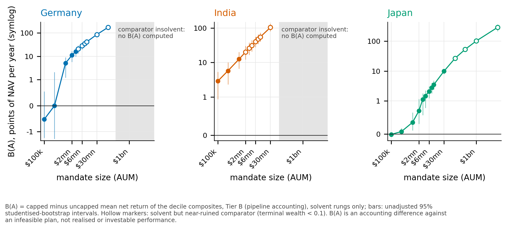
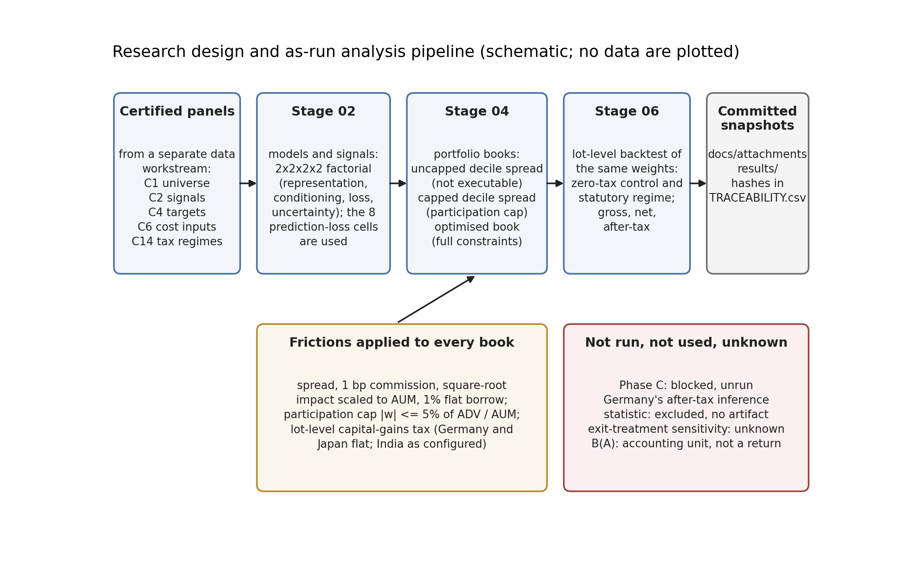
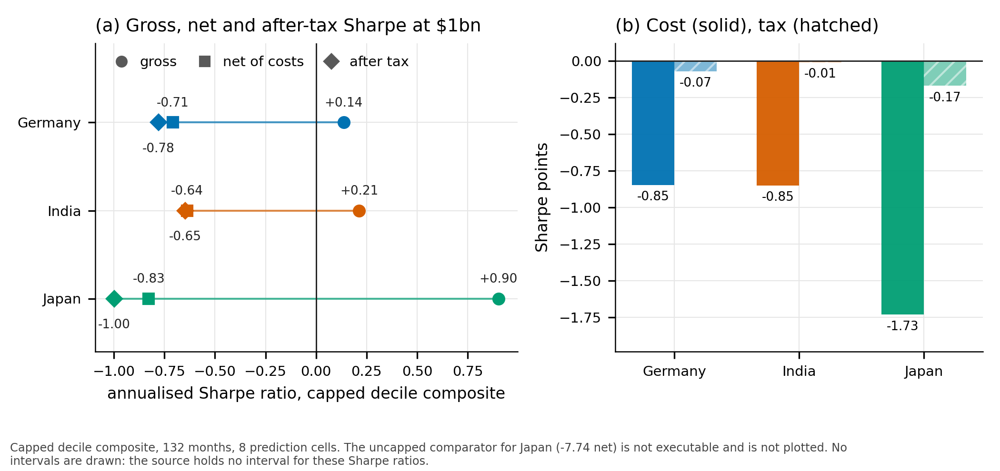
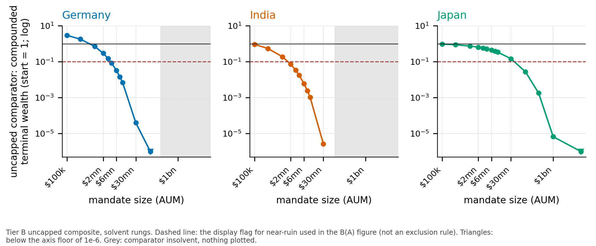
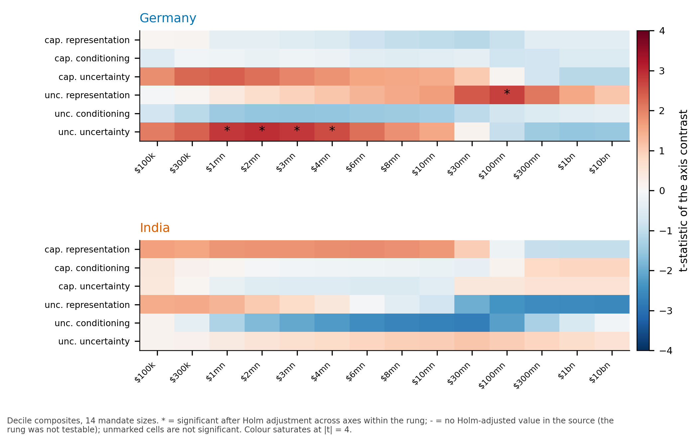
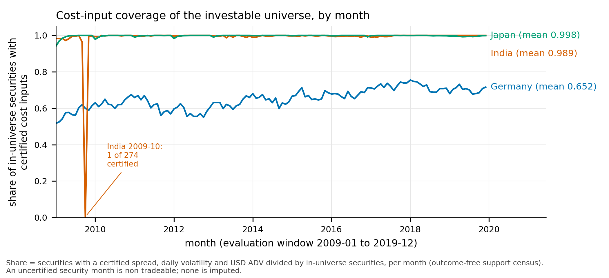
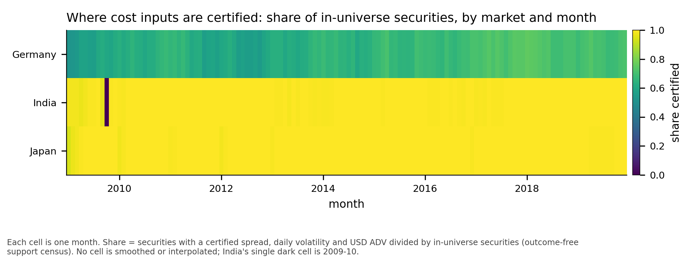
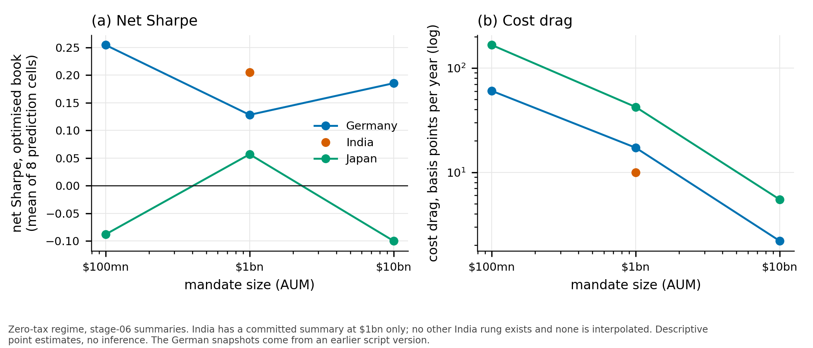

<div align="center">

# How Much of a Machine-Learning Stock Signal Survives the Real World?

### Trading costs, capacity limits and capital-gains tax in Germany, India and Japan, 2009–2019

*An as-run measurement of what happens to a machine-learning equity signal when it meets AUM-sized trading costs, a cap on daily-volume participation and each country's statutory capital-gains tax.*




</div>

---

## The question

Machine-learning models can rank stocks very well on paper. A portfolio built from the top of that ranking looks excellent **before** any cost is charged. But a real investor pays to trade, moves prices when the order is large, is not allowed to be too large a share of a stock's daily volume, and owes tax on realised gains.

> **How much of the signal is left once those three frictions are applied, and how does the answer change with the size of the mandate and with the country's tax law?**

We study this in three non-US markets that differ in how they tax gains:

| Market | Capital-gains regime in the tax engine | Role in the design |
|---|---|---|
| 🇩🇪 Germany | flat short-term rate, no long-term category | flat-statute case |
| 🇯🇵 Japan | flat short-term rate, no long-term category | flat-statute case |
| 🇮🇳 India | short-term rate plus an exempt long-term category, with a dated 2018 reform | the contrast case |

The same signals, the same investable universe and the same lot-level accounting are used in all three, so differences between markets are not differences in method.

## What we built

<div align="center">

</div>

1. **Signals.** A 2×2×2×2 factorial of model design choices (representation, conditioning, loss, uncertainty) produces monthly stock scores. Headline results use the eight prediction-loss cells.
2. **Three books.** An *uncapped decile spread* (not executable, used only as a comparator), a *capped decile spread* (weights clipped to a participation limit, the first executable object) and an *optimised book* with the full constraint set.
3. **Costs indexed to AUM.** Per name: half the spread plus commission, plus a square-root price-impact term that grows with `AUM / ADV`. Mandates run from $100k to $10bn.
4. **Participation cap.** No position may exceed 5% of a stock's average daily volume, expressed in portfolio weight.
5. **A lot-level tax engine.** Tax lots, HIFO lot selection and dated statutes, so holding-period effects are real, not a flat haircut.
6. **Inference.** Paired studentised stationary bootstrap, Holm adjustment within a family, Newey–West Sharpe tests.

An uncertified security-month is **non-tradeable and is never imputed**. This rule matters (see the cautionary case below).

## What we found

### 1. Strong before costs, negative once the book is executable

The gross decile composites have Sharpe ratios of +2.31 (Germany), +1.20 (India) and +1.28 (Japan). At a **$1bn** mandate the participation-capped, executable decile book has a **negative net Sharpe ratio in all three markets** (−0.71, −0.64, −0.83). Where a net Sharpe ratio for the full optimised book is traceable (India, Japan) it is **not distinguishable from zero**.

<div align="center">

</div>

### 2. The participation cap matters more the harder it binds

We measure the cap's effect as **B(A)**: the annualised net-return difference between the capped and uncapped decile composites at mandate size A. It rises monotonically with mandate size on all 35 rungs where the comparator survives.

**An honest reading matters here.** The uncapped comparator is an *infeasible* plan, and at large mandates it is close to ruined. B(A) is therefore an **accounting difference against a plan nobody could run**. It shows how hard the constraint binds. It is not a performance gain and it is not convertible into Sharpe points.

<div align="center">

</div>

### 3. Tax law decides whether a holding-period channel can exist

Under the German and Japanese flat regimes the long-term share of realised gains is **exactly zero**, a mechanical consequence of the statute (and a useful check that the tax engine reproduces it). In India it is about 0.59. On the executable decile book the tax channel is **8 to 19 times larger in the flat regimes than in India**, which is itself borderline significant.

### 4. Model design choices are not detectable at this power

For representation, conditioning and uncertainty, none of 42 axis-rung tests is significant on the capped decile book in either Germany or India. The minimum detectable effect is roughly a quarter of a Sharpe point, so this is a bound, not proof that design does not matter.

<div align="center">

</div>

## A cautionary case: when coverage manufactures a result

An early capacity ladder formed deciles on Germany's *signal-bearing* universe instead of its *investable* one. Cost-input coverage is 65% in Germany against 99% in India, and the ladder broke the non-tradeability rule in Germany only. It produced a clean, theory-consistent, highly significant effect (t = −6.1) that **survived two robustness checks** because both varied parameters inside the wrong universe. Enforcing the rule removed it. The lesson is general: robustness checks that vary parameters inside a frame do not test the frame. We keep the case in the paper as a worked methods warning.

<div align="center">

</div>

## Scope and honesty

* **As-run measurement.** All numbers use the original exit treatment of delisted or missing positions. Their sensitivity to a different exit rule is **unknown**, and that revised analysis was deliberately not run.
* **Modest contribution.** No new method and no new mechanism. The US literature already shows that implementable performance falls with AUM; what is added is non-US coverage, statute-specific tax and an ADV participation constraint on one book.
* **Low power.** Eight prediction cells and 132 months.
* **Three jurisdictions only**, and turnover is endogenous, so tax-drag orderings are descriptive.

## Figures and tables

The repository ships **26 figures** (PDF, SVG, 300-dpi PNG) and **25 tables** (CSV, LaTeX, Markdown), each built reproducibly from a committed artifact with a recorded SHA-256.

| Where | What |
|---|---|
| [`paper_assets_as_run_only/figures/`](paper_assets_as_run_only/figures) | 4 main-text and 17 supplementary figures, plus diagnostics |
| [`paper_assets_as_run_only/tables/`](paper_assets_as_run_only/tables) | 4 main-text and 18 supplementary tables, plus diagnostics |
| [`paper_assets_as_run_only/ASSET_CATALOG.md`](paper_assets_as_run_only/ASSET_CATALOG.md) | Captions, sources, hashes, limits and where each belongs in the paper |

<div align="center">


</div>

## Read the paper

* [`submission_candidate_as_run_only/manuscript.md`](submission_candidate_as_run_only/manuscript.md): the manuscript, with every number re-derived from committed artifacts.
* [`research_handoff_for_writing/`](research_handoff_for_writing): the writing package (guide, figures, tables, literature review, limitations).

## Reproduce

```bash
python -m pip install -e .                      # Python 3.12
python tools/check_submission_candidate.py      # every manuscript number is re-derived and hash-checked
python tools/make_paper_assets.py               # rebuild all figures and tables
python tools/make_paper_assets.py --verify      # verify them against the manifest
```

The heavy stages that produced the committed result snapshots (model training, portfolio construction, the lot-level backtest) read licensed vendor-derived panels that are **not** in this repository, so they are not rerun by the commands above.

## Repository map

| Path | Contents |
|---|---|
| `src/alphacomb/` | The package: contracts, models, portfolio construction, risk, tax engine, validation |
| `pipelines/` | Stage scripts: train, construct portfolios, after-tax evaluation |
| `tools/` | Experiment and audit scripts, the manuscript checker, the asset generators |
| `tests/` | Unit and integration tests |
| `configs/` | Base, portfolio, model and risk configuration |
| `docs/` | Specifications, audits, results write-ups, [developer notes](docs/DEVELOPER_NOTES.md) |
| `results/`, `docs/attachments/` | Committed result snapshots |

## Data and licensing

Raw vendor data are not included. The repository does contain derived result tables and portfolio-level series produced from licensed vendor data (WRDS/Compustat Global lineage). Whether each derived file may be redistributed has not been verified against the vendor's terms; check before reusing any data. No licence file has been added yet.
